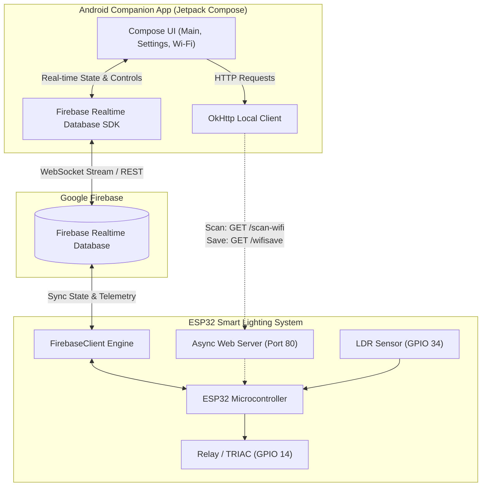

# 📱 ESP32 Smart Lighting System — Android Companion App

[](https://kotlinlang.org/)
[](https://developer.android.com/jetpack/compose)
[](https://firebase.google.com/)
[](LICENSE)
[-3DDC84.svg?logo=android&logoColor=white)](https://developer.android.com)

A modern, native Android companion application built with **Jetpack Compose** and **Material 3** for controlling and monitoring the [ESP32 Smart IoT Lighting System](https://github.com/LoNE-W0LvES/esp32-smart-lighting-system). 

The app provides live hardware telemetry, bi-directional cloud control via **Firebase Realtime Database**, automated astronomical & light sensor threshold calibration, and local direct-to-device **Wi-Fi provisioning** over HTTP.

---

## 🌟 Key Features

- **⚡ Real-Time Hardware Telemetry**:
  - Live ambient light sensor (LDR) analog readings (`0–4095`).
  - Active device uptime formatted in days, hours, minutes, and seconds.
  - Heartbeat-driven online/offline connection state indicator.
  - Local device IP address reporting.

- **💡 Remote Cloud Control**:
  - Instant Light ON/OFF toggle synchronized across cloud and hardware.
  - Manual override toggle (`Manual Mode` vs. `Auto Astronomical/LDR Mode`).

- **⚙️ Deep Hardware Calibration & Geolocation**:
  - **LDR Night Threshold (`ln`)**: Adjust ambient darkness trigger level (`0–4095`).
  - **LDR Day Threshold (`ud`)**: Adjust daylight cutoff level (`0–4095`).
  - **Light Timeout (`lt`)**: Configure operational duration on detection (`1–120s`).
  - **Astronomical Coordinates (`lat`, `lon`)**: Sync latitude and longitude for onboard sunrise/sunset calculation.
  - One-tap Firebase sync trigger (`sd = 1`) to signal hardware to update flash storage.

- **📶 Local Device Wi-Fi Provisioning**:
  - Direct communication with ESP32 SoftAP web server via **OkHttp** and **Gson**.
  - On-demand Wi-Fi network scanning (`GET /scan-wifi`) displaying SSIDs, RSSI signal strength (dBm), and encryption status.
  - Wi-Fi credentials transmission (`GET /wifisave?s={ssid}&p={password}`) for persistent onboarding.

- **🎨 Modern Android Architecture**:
  - Declarative UI with **Jetpack Compose** & **Material 3**.
  - Dynamic Color theming support (Android 12+) with light and dark mode palettes.
  - Jetpack Navigation (`NavHost`) architecture.

---

## 🏛 System Architecture & Data Flow



---

## 📱 Application Screens

### 1. `MainScreen` (`ui/MainScreens.kt`)
The primary dashboard displaying:
- **Device Connectivity Status**: Green (Online) / Red (Offline) indicator badge based on active uptime counter.
- **Device IP**: Displays local IP fetched from `/device/w/ip`.
- **Uptime Counter**: Live calculation in format `X d X h X m X s`.
- **LDR Sensor Value**: Raw ADC reading (`0–4095`) from the light-dependent resistor.
- **Light Control Button**: Dynamic green/gray button triggering light activation (`/device/cs/c/lc`).
- **Manual Mode Button**: Dynamic blue/gray button toggling manual override (`/device/cs/c/ms`).

### 2. `SettingsScreen` (`ui/SettingsScreen.kt`)
Hardware parameter tuning and calibration interface:
- **LDR Timeout Slider**: Set duration from `1s` to `120s`.
- **LDR Night Threshold Slider**: Configures activation sensitivity (`0–4095`).
- **LDR Day Threshold Slider**: Configures daytime deactivation limit (`0–4095`).
- **Latitude & Longitude Inputs**: Sets geolocation coordinates for solar time calculation.
- **Save Configuration Action**: Writes configuration payload to `/device/cs/s` and triggers device update flag `sd = 1`.

### 3. `WiFiSettingsScreen` (`ui/WiFiSettingsScreen.kt`)
Direct local network onboarding interface:
- **Scan Networks**: Triggers `GET http://<deviceIp>/scan-wifi` to scan 2.4 GHz access points.
- **Network List**: Displays SSID, RSSI signal in dBm, and security status (Encrypted / Open).
- **Credential Dispatch**: Encodes SSID and password into `GET http://<deviceIp>/wifisave` to store in ESP32 NVS flash.

---

## ☁️ Firebase Realtime Database Schema

```json
{
  "sensor": {
    "lv": 450,
    "ut": 3600
  },
  "device": {
    "cs": {
      "c": {
        "lc": 1,
        "ms": 0
      },
      "s": {
        "sd": 1,
        "lt": 30,
        "ud": 800,
        "ln": 200,
        "lat": 23.1697,
        "lon": 89.2167
      }
    },
    "w": {
      "ip": "192.168.1.105"
    }
  }
}
```

| Path | Key | Type | Description |
| :--- | :--- | :--- | :--- |
| `/sensor` | `lv` | Integer | Live analog LDR reading (`0–4095`) |
| `/sensor` | `ut` | Long | Device uptime in seconds |
| `/device/w` | `ip` | String | Local IP address assigned by Wi-Fi router |
| `/device/cs/c` | `lc` | Integer | Light Control switch (`0 = OFF`, `1 = ON`) |
| `/device/cs/c` | `ms` | Integer | Manual Override switch (`0 = Auto`, `1 = Manual`) |
| `/device/cs/s` | `lt` | Integer | Light activation timeout (seconds) |
| `/device/cs/s` | `ln` | Integer | LDR Night lower threshold limit |
| `/device/cs/s` | `ud` | Integer | LDR Day upper threshold limit |
| `/device/cs/s` | `lat` | Double | Latitude for sunrise/sunset calculations |
| `/device/cs/s` | `lon` | Double | Longitude for sunrise/sunset calculations |
| `/device/cs/s` | `sd` | Integer | Save data flag (`1` triggers EEPROM/NVS write on MCU) |

---

## 📁 Repository Structure

```
.
├── .gitignore               # Git ignore rules for Android / Gradle builds
├── README.md                # Comprehensive project documentation
├── build.gradle             # Application-level Gradle build configuration
├── MainActivity.kt          # Activity entry point and Compose NavHost
└── ui/
    ├── MainScreens.kt       # Main telemetry dashboard and control toggles
    ├── SettingsScreen.kt    # Calibration sliders and geolocation settings
    ├── WiFiSettingsScreen.kt# Local HTTP Wi-Fi scanner and provisioning tool
    └── theme/
        ├── Color.kt         # Color palette definitions
        └── Theme.kt         # Material 3 theme configuration & typography
```

---

## 🛠 Tech Stack & Dependencies

- **Language**: Kotlin 1.9+
- **UI Framework**: Android Jetpack Compose (BOM)
- **Design System**: Material Design 3 (`androidx.compose.material3`)
- **Navigation**: Jetpack Navigation Compose (`androidx.navigation:navigation-compose`)
- **Backend / Cloud**: Firebase Realtime Database KTX (`com.google.firebase:firebase-database-ktx`)
- **Networking**: Square OkHttp (`com.squareup.okhttp3:okhttp`)
- **Serialization**: Google Gson (`com.google.code.gson:gson`)
- **Coroutines**: Kotlin Coroutines (`kotlinx-coroutines-android`)

---

## 🚀 Getting Started

### Prerequisites

- **Android Studio Hedgehog (2023.1.1)** or newer
- **Android SDK Platform 34** (compileSdk 34, minSdk 25)
- **Google Services Configuration**: A configured Firebase project with Realtime Database enabled

### Installation & Setup

1. **Clone the repository:**
   ```bash
   git clone https://github.com/LoNE-W0LvES/esp32-smart-lighting-android.git
   cd esp32-smart-lighting-android
   ```

2. **Add Google Services Configuration:**
   - Download your `google-services.json` file from the [Firebase Console](https://console.firebase.google.com/).
   - Place `google-services.json` into the root or `app/` module directory.

3. **Open in Android Studio:**
   - Launch Android Studio and select **Open Project**.
   - Let Gradle sync all project dependencies.

4. **Build and Run:**
   - Connect an Android device with Developer Options & USB Debugging enabled, or launch an Android Emulator.
   - Click **Run 'app'** (`Shift + F10`).

---

## 🔗 Related Projects

- **Hardware Firmware Repository**: [ESP32 Smart IoT Lighting System](https://github.com/LoNE-W0LvES/esp32-smart-lighting-system) — Complete PlatformIO C++ firmware with Wokwi simulation, NTP solar math, and non-blocking Ticker scheduling.

---

## 👤 Author & License

- **Author**: MD. Nafiur Rahman ([@LoNE-W0LvES](https://github.com/LoNE-W0LvES))
- **License**: Released under the [MIT License](LICENSE).
